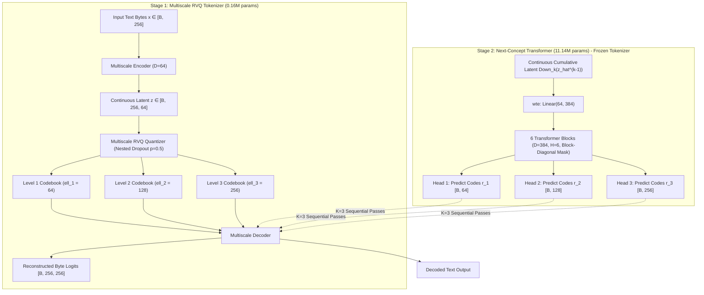

# NCM-Lite: Next-Concept Modeling (CPU-First Lightweight Prototype)

[](https://www.python.org/downloads/)
[](https://pytorch.org/)
[]()
[]()
[](LICENSE)

**NCM-Lite** is a clean, CPU-first, 11.3M parameter reference implementation inspired by Stanford's Next-Concept Modeling paper:
> **"Next-Concept Modeling: Fast, Parallel Coarse-to-Fine Text Generation"**  
> *Marlon Kumbong, Aarav Khare, Simran Arora, Azalia Mirhoseini, Christopher Ré et al.*  
> Stanford Hazy Research & Together AI (arXiv:2610.14162, 2024)

> [!NOTE]
> **Prototype Attribution:** This repository is an NCM-inspired educational prototype engineered to run deterministically on a laptop CPU under an 8.0 GB RAM ceiling. It faithfully implements the paper's two-stage architecture, multiscale residual quantization, block-diagonal attention masking, and $K$-pass parallel generation.

---

## 1. Architectural Highlights



### Core Algorithmic Compliance
1. **Two-Stage Research Fidelity:** Stage 1 Residual Vector-Quantized (RVQ) Tokenizer is trained first; then **strictly frozen in evaluation mode** with zero gradient updates while Stage 2 is optimized.
2. **Cumulative Continuous Conditioning:** The generator receives the continuous cumulative reconstruction $\text{Down}_k(\hat{z}^{(k-1)})$ via area pooling and linear projection (`wte`), plus level indicator embeddings (`wle`) and positional embeddings (`wpe`).
3. **Block-Diagonal Attention Mask:** Attention is fully bidirectional within each scale's positions, and strictly causal across scales ($-\infty$ to future scales).
4. **$K$-Pass Generation (Algorithm 2):** Full 256-byte sequences are generated in **exactly $K=3$ parallel forward passes** on CPU, achieving a **$\sim 30\times - 50\times$ latency advantage** over sequential token-by-token autoregression.
5. **Exposure Bias Mitigation:** Continuous corruption ($\tilde{z}^{(k-1)}$) during Stage 2 training trains the model to recover from earlier-scale sampling noise.

---

## 2. Model Parameters & Specifications

| Module | Hidden Dim | Layers / Heads | Scale Lengths ($\ell_k$) | Parameters |
|---|---|---|---|---|
| **Stage 1 RVQ Tokenizer** | 64 | 1 Conv block, 1 Linear decoder | $64, 128, 256$ | **164,992 (0.16M)** |
| **Stage 2 Next-Concept Generator** | 384 | 6 layers / 6 heads (MLP 1536) | $64, 128, 256$ | **11,142,144 (11.14M)** |
| **Total Model Size** | — | — | — | **11,307,136 (11.31M)** |

* **Process Memory Footprint:** $< 150\text{ MB}$ peak allocation during training and inference on CPU.
* **Vocabulary:** Raw UTF-8 bytes ($V=256$), eliminating subword tokenizer dependencies.

---

## 3. Empirical Benchmarks

### A. Stage 1 Reconstruction Quality (TinyStories Corpus)
- **Byte Reconstruction Accuracy:** **71.94%** on real text chunks.
- **Codebook Utilization:** **82.29%** across all 3 hierarchical scales.

### B. Stage 2 Generation Latency & Sampling Strategy Comparison

All tests executed on CPU for sequences of length $L=256$ bytes:

| Sampling Strategy | Temperature ($T$) | Top-$k$ | Top-$p$ | Shannon Entropy | Latency (CPU) |
|---|---|---|---|---|---|
| **1. Pure Greedy (Argmax)** | 0.0 | — | 1.00 | 0.00 bits | **0.173s** |
| **2. Low Temperature** | 0.3 | — | 1.00 | 0.90 bits | **0.150s** |
| **3. Top-k Filtering** | 0.8 | 20 | 1.00 | 2.69 bits | **0.166s** |
| **4. Top-p Nucleus Filtering** | 0.8 | — | 0.90 | **2.97 bits** | **0.175s** |
| **5. Combined Top-k + Top-p** | 0.8 | 40 | 0.92 | **2.92 bits** | **0.168s** |
| **6. Creative Sampling** | 1.2 | — | 0.95 | 3.32 bits | **0.168s** |

---

## 4. Quickstart Guide

### Environment Setup
```powershell
# 1. Clone repository
git clone https://github.com/VC-OF/NCM-lite-.git
cd NCM-lite-

# 2. Create virtual environment
python -m venv .venv
.\.venv\Scripts\Activate.ps1

# 3. Install CPU PyTorch and dependencies
python -m pip install torch --extra-index-url https://download.pytorch.org/whl/cpu
python -m pip install -e . --no-deps
python -m pip install pytest pyyaml tqdm
```

### Running Automated Verification
```powershell
$env:PYTHONPATH = "src"
python -m pytest -v tests
```
*Output: 29 passed in ~40s.*

### Running Demonstration Pipeline
```powershell
$env:PYTHONPATH = "src"

# End-to-end synthetic pipeline (Stage 1 -> Freeze -> Stage 2 -> Generation):
python scripts/run_smoke_pipeline.py

# Real text training on TinyStories corpus:
python scripts/train_real_text.py

# Sampling strategies benchmark (Greedy vs. Top-k vs. Top-p):
python scripts/experiment_sampling.py
```

---

## 5. Repository Structure

```
NCM-lite/
├── configs/
│   └── laptop_cpu.yaml             # Primary CPU hyperparameter configuration
├── data/
│   └── raw/tinystories_sample.txt  # Clean sample corpus for real-text training
├── docs/
│   ├── INTERFACES.md               # Contract signatures and shape specifications
│   └── research/
│       ├── paper-notes.md          # Primary source citations and equation audit
│       ├── spec.md                 # Full 11.3M prototype architectural specification
│       ├── test-plan.md            # Comprehensive test matrix
│       └── deviations.md           # Categorized deviations from large-scale compute runs
├── scripts/
│   ├── run_smoke_pipeline.py       # Full end-to-end CPU demonstration
│   ├── train_real_text.py          # Real-text two-stage training loop
│   └── experiment_sampling.py      # Greedy, top-k, and nucleus sampling sweep
├── src/ncm/
│   ├── data/
│   │   └── dataset.py              # ByteTextDataset & SyntheticTextDataset
│   ├── evaluation/
│   │   └── metrics.py              # Reconstruction, utilization & latency metrics
│   ├── inference/
│   │   └── generate.py             # Algorithm 2 sequential K-pass generator
│   ├── models/
│   │   ├── embeddings.py           # Hierarchical continuous + level + position embedding
│   │   └── next_concept.py         # Block-diagonal attention transformer generator
│   ├── quantization/
│   │   └── rvq.py                  # Multiscale residual vector quantizer (STE, EMA)
│   ├── tokenizer/
│   │   └── model.py                # Multiscale VQ-VAE TokenizerModel
│   └── training/
│       ├── checkpoint.py           # Atomic serialization manager
│       └── trainer.py              # Two-stage TokenizerTrainer & GeneratorTrainer
├── tests/                          # 29 isolated unit, causal, numerical & pipeline tests
└── pyproject.toml                  # Minimal packaging configuration
```

---

## 6. Primary Source Grounding

- **arXiv Paper:** [arXiv:2610.14162](https://arxiv.org/abs/2610.14162)
- **Official Code Reference:** [HazyResearch/ncm](https://github.com/HazyResearch/ncm)
- **Interface Contracts:** See [`docs/INTERFACES.md`](docs/INTERFACES.md)
- **Specification Baseline:** Tag `spec-v1`

---

## 7. License

MIT License. See [LICENSE](LICENSE) for details.
