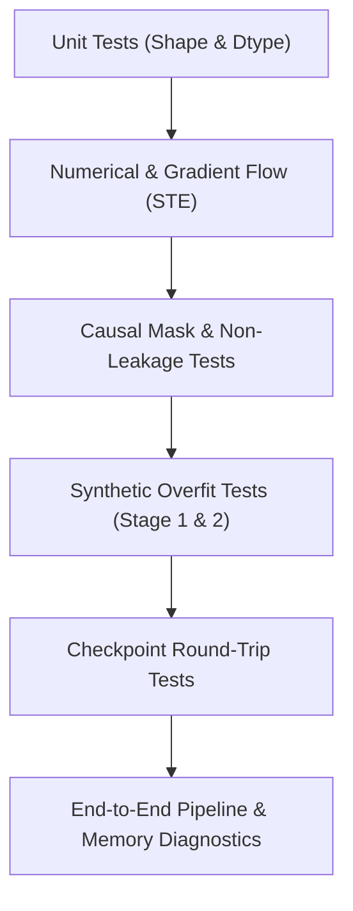

# NCM-Lite Comprehensive Test Plan (`spec-v1`)

**Document Status:** Approved Test Specification  
**Version:** 1.0.0  
**Author:** Agent 00 (Research Architect)  
**Execution Environment:** CPU (`pytest -v --tb=short`)

---

## 1. Test Architecture Overview

Every module in NCM-Lite must pass isolated unit tests on synthetic mock tensors before integration.
No agent is permitted to claim a test passed without running `pytest` and inspecting the terminal output.



---

## 2. Test Suite Matrix

### Module 1: Tokenizer & Residual VQ (`tests/tokenizer/`, `tests/quantization/`)

| Test Identifier | Test Target | Verification Criteria | Expected Outcome |
|---|---|---|---|
| `test_encoder_output_shapes` | `MultiscaleEncoder` | Pass $[B=2, T=256]$; check returned latents $[z_1, z_2, z_3]$. | $z_1 \in [2, 64, 64]$, $z_2 \in [2, 128, 64]$, $z_3 \in [2, 256, 64]$. |
| `test_rvq_code_indices_range` | `ResidualVectorQuantizer` | Pass random latents; inspect emitted discrete code indices. | Indices are `torch.int64`, strictly within $[0, V_{\text{code}} - 1]$. |
| `test_rvq_ste_gradient_flow` | `ResidualVectorQuantizer` | Compute scalar loss from $q_k$; execute `.backward()`. | Gradient flows to input latents $z_k$; `input_latents.grad` is non-zero and finite. |
| `test_rvq_codebook_loss_values` | `ResidualVectorQuantizer` | Compute codebook & commitment loss. | Loss is non-negative, finite, and strictly decreases when representations align. |
| `test_decoder_output_shape` | `MultiscaleDecoder` | Pass quantized latents $[q_1, q_2, q_3]$. | Reconstructed logits strictly shape $[B=2, T=256, V_{\text{vocab}}=256]$. |
| `test_tokenizer_stage1_overfit` | `TokenizerModel` | Optimize a single fixed 256-byte sequence for 30 steps on CPU. | Reconstruction cross-entropy loss drops by $\ge 70\%$. |

### Module 2: Next-Concept Transformer (`tests/models/`)

| Test Identifier | Test Target | Verification Criteria | Expected Outcome |
|---|---|---|---|
| `test_code_embedding_dimensions` | `HierarchicalCodeEmbedding` | Pass flattened codes of length 448 with level indicators. | Output tensor is $[B=2, 448, 384]$, dtype `torch.float32`. |
| `test_block_causal_mask_structure` | `NextConceptTransformer` | Inspect generated attention mask $M \in \mathbb{R}^{448 \times 448}$. | Positions at scale $k$ cannot attend to scale $k+1$ ($-\infty$); bidirectional within scale $k$ ($0.0$). |
| `test_generator_output_shapes` | `NextConceptTransformer` | Pass list of target codes $[c_1, c_2, c_3]$. | Output logits $[Z_1, Z_2, Z_3]$ match shapes $[2, 64, 256], [2, 128, 256], [2, 256, 256]$. |
| `test_no_future_leakage` | `NextConceptTransformer` | Perturb future scale codes $c_3$; inspect logits of earlier scale $Z_1$. | $Z_1$ logits are numerically identical before and after perturbing $c_3$. |
| `test_generator_parameter_count` | `NextConceptTransformer` | Calculate total trainable parameters under primary config. | Total parameter count between $10\text{M}$ and $15\text{M}$ ($11.2\text{M} \pm 10\%$). |
| `test_generator_synthetic_overfit`| `NextConceptTransformer` | Train on a single batch of mock concept codes for 30 steps. | Level prediction cross-entropy loss drops monotonically. |

### Module 3: Training & Data (`tests/training/`, `tests/data/`)

| Test Identifier | Test Target | Verification Criteria | Expected Outcome |
|---|---|---|---|
| `test_byte_dataset_chunking` | `ByteTextDataset` | Load UTF-8 string sample. | Emits tensor of shape $[256]$, values within $[0, 255]$, type `int64`. |
| `test_stage2_frozen_tokenizer` | `GeneratorTrainer` | Execute 2 generator training steps. | `tokenizer.parameters()` have `grad is None` or frozen; generator weights update. |
| `test_checkpoint_roundtrip` | `CheckpointManager` | Save model state, reload into fresh model instance. | All layer parameters match exactly (`torch.equal(p1, p2)` is `True`). |
| `test_resume_training_step` | `TokenizerTrainer` / `GeneratorTrainer` | Run 5 steps, save, reload, run step 6. | Step index correctly resumes at 6; loss continues trajectory. |

### Module 4: Inference & Integration (`tests/integration/`, `tests/inference/`)

| Test Identifier | Test Target | Verification Criteria | Expected Outcome |
|---|---|---|---|
| `test_parallel_inference_steps` | `generate_hierarchical_codes` | Measure number of forward calls to generator. | Exactly $K=3$ forward passes executed for full sequence generation. |
| `test_decode_hierarchical_codes` | `decode_hierarchical_codes` | Pass valid code indices through frozen tokenizer decode. | Emits valid UTF-8 string without raising exceptions. |
| `test_end_to_end_smoke_pipeline` | Full System | Stage 1 encode $\to$ RVQ $\to$ Stage 2 predict $\to$ Decode. | Full pipeline runs on CPU within $< 2.0\text{ seconds}$ per sample, peak RAM $< 1.5\text{ GB}$. |

---

## 3. Execution Protocol

All tests must be run via the repository virtual environment:
```powershell
.\.venv\Scripts\python.exe -m pytest -v
```

Before submitting a branch for merge review:
1. Run all unit tests for your owned folder: `.\.venv\Scripts\python.exe -m pytest tests/<module>/`.
2. Verify zero warnings, zero errors, and clean exit code 0.
3. Record exact output in the task handoff report.
